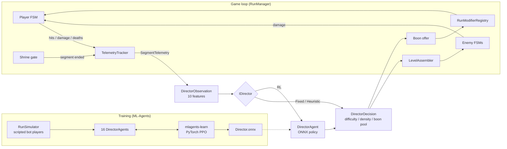

# The Odyssey: AI-Driven 2D Action Game (beta)

A 2D side-scrolling action platformer inspired by Homer's *Odyssey* (Book IX, the Island of the
Cyclops), built in **Unity 6 (6000.3) and C#**. Its **AI Director** is trained with
**reinforcement learning (ML-Agents PPO / PyTorch)**. At every segment boundary the Director reads
the player's performance telemetry. It then picks how hard the next procedurally stitched chunk
is, how many enemies it spawns, and which tier of rogue-lite boons the shrine offers. The goal is
to keep each player in a target challenge band.

> **Status: beta.** There is one level, placeholder art and a simulated-player-trained Director.
> The tables under "Status" and "Limitations" list what is finished, what is partial and what has
> not been verified yet.

## Features

| Resume claim | Where it lives |
|---|---|
| 2D side-scroller inspired by the Odyssey | `Level01`: opening dialogue → 5 segments → Polyphemus' cave → ship → end screen |
| State-machine combat | `Runtime/FSM` (generic FSM), `Player/States` (Idle, Run, Jump, Fall, Attack, Dodge, Hurt, Dead), `Enemies/States` (Patrol, Chase, Melee/Ranged Attack, Hurt, Dead). Frame-data attacks use a hitbox/`IDamageable` interface |
| Rogue-lite modifier system | `Runtime/Modifiers`: 12 *Boons of the Gods* (ScriptableObjects) and a pure-C# `RunModifierRegistry` with stacking rules |
| Generates levels | `Runtime/LevelGen`: ASCII-authored chunks, a seeded chunk selector and a runtime `LevelAssembler` |
| RL-based AI Director, real-time tuning | `Runtime/Director`: `IDirector` with Fixed, Heuristic and RL (`DirectorAgent` + ONNX via Inference Engine) implementations, called at each shrine during play |
| ML-Agents, PyTorch | `ml/configs/director_ppo.yaml` trained with `mlagents-learn` (PyTorch PPO) and exported to ONNX |

## Controls
- **A/D** or arrow keys: move
- **Space/W**: jump (hold for a higher jump)
- **J** or left click: spear attack
- **K/Shift**: dodge (gives i-frames)
- **Esc**: pause
- **F1**: show or hide the live Director readout
- **1/2/3**: pick a boon at a shrine
- Gamepad is supported.

## Getting started
1. Open the folder in **Unity 6000.3.9f1** (Unity Hub → Add → this folder). The first import
   resolves `com.unity.ml-agents@4.0.0`, which pulls in Inference Engine 2.2.1.
2. Run the menu **Odyssey → Build Project Content**. It creates:
   - the physics layers
   - every data asset (`Assets/Data`, `Assets/Resources/GameDatabase.asset`)
   - the five scenes: MainMenu, Level01, EndScreen, DirectorTraining and DirectorEval
3. Open `Assets/Scenes/MainMenu.unity` and press **Play**. On the title screen, the *AI Director*
   button cycles between RL, Heuristic and Fixed.

To run the tests, use **Window → General → Test Runner → EditMode → Run All**.

## Architecture



Design decisions:
- **One generic FSM** (`StateMachine` + `IState`) drives the player and every enemy. States are
  plain C# classes, and the owner declares all transitions in one method. "Any" transitions
  (→ Hurt, → Dead) take priority over the others.
- **Combat uses frame data.** Each attack goes windup → active → recovery. The hitbox is open
  only during the active frames, and each target is hit at most once per swing. Damage goes
  through `IDamageable` and `DamageInfo`.
- **Gameplay is data-driven.** Enemies (`EnemyConfig`), boons (`BoonDefinition`), chunks
  (`ChunkDefinition`) and dialogue (`DialogueSequence`) are ScriptableObjects, so a new enemy or
  boon is a new asset, not new code.
- **Logic can be tested without the engine.** `HealthModel`, `RunModifierRegistry`,
  `ChunkLayout`, `RunSimulator`, the directors and the reward are free of MonoBehaviours, so
  edit-mode tests cover them.
- **Scenes are generated.** An editor builder creates them, and UI is built from code, so scenes
  hold only bootstrap objects. That means no fragile prefab references.

## AI Director

| | |
|---|---|
| **Decision point** | Each shrine gate, i.e. between segments (5 per run) |
| **Observation (10, all in [0,1])** | HP lost, HP at end, time ÷ par, deaths, hit rate, enemy-HP cleared, boons held, run progress, last difficulty, last density |
| **Actions** (MultiDiscrete 3×3×2) | Next chunk difficulty (easy/medium/hard, which also sets enemy tier ×0.8/1.0/1.3); enemy density (40/70/100% of the chunk's slots filled); boon pool (common/rare) |
| **Reward per segment** | +0.6 if HP lost is in [15%, 50%] and no death; +0.4 if time is in [0.75, 1.5]× par; −1.0 per death; −0.5 for a trivial segment (<5% HP lost and fast); −0.1 for handing out rare boons; −1.0 extra when the run fails (3 deaths) |
| **Policy** | PPO, MLP 2×64, CPU (`ml/configs/director_ppo.yaml`) |

**Training.** Training uses scripted *simulated players* rather than humans. `RunSimulator` is a
stochastic model of a run with Novice, Average and Expert skill profiles (±0.05 jitter per
episode). It reproduces the game's rules: HP carries over, shrines heal 15% and grant a boon, and
3 deaths end the run. The training scene runs 16 agents in parallel.

```bat
ml\train_director.bat director_v1
```

The script activates the `odyssey_ai` conda env (Python 3.10.12, mlagents 1.1.0, torch 2.2.2+cpu)
and runs `mlagents-learn`. When it prints *"Listening on port 5004"*, open `DirectorTraining` and
press Play. After training it copies `Director.onnx` to `Assets/ML/Models/` and exports the
TensorBoard curves to `results/training/`. Finally, run **Odyssey → Assign Director Model To
Scenes** in Unity.

**In game.** `RLDirector` steps the Academy manually at each shrine, so inference is synchronous.
Each decision is logged to the console and appended to `telemetry.csv` in
`Application.persistentDataPath`, and F1 shows the live readout. If no model is assigned, the
agent falls back to the heuristic director, and the HUD says so.

## Evaluation
Run **Odyssey → Run Director Evaluation**. It compares Fixed, Heuristic and RL on the same scripted
players and the same seeds (300 runs per skill level, seeds 1000–1299), then writes
`results/director_eval.md` and `.csv`.

Metrics, per skill level:
- completion rate
- **time-in-target-band** (share of segments with HP and time in band)
- standard deviation of that share across runs
- HP lost per segment
- deaths per run
- share of trivial segments
- mean return

**Results: TODO.** No trained model has been committed yet. This section will link
`results/director_eval.md` and `results/training/training_curves.png` once the training run and the
evaluator have been run. All numbers will come from those files.

## Tests (edit mode)
| Suite | What it checks |
|---|---|
| `StateMachineTests` | Transition firing, Exit→Enter order, Any-transition priority, no self-re-entry |
| `HealthModelTests` | Damage, i-frames, single death event, heal clamp, max-HP change |
| `ModifierRegistryTests` | `(base + flat) × (1 + Σpct)`, max stacks, clear, boon offers (pool and one per god) |
| `LevelGenTests` | ASCII parse and rectangle merging, slots, stand height, deterministic slot/chunk picks |
| `DirectorTests` | Observation size and range, reward ordering, heuristic adapts, simulator determinism, evaluation seeding |

`tools/chunk_maps.py` checks each chunk map: a BFS with the player's jump limits confirms every
chunk can be crossed and no enemy slot is floating. With `--write` it also regenerates
`DefaultChunks.cs`.

## Project layout
```
Assets/Scripts/Runtime/  Core, FSM, Combat, Player, Enemies, Modifiers, LevelGen, Level, Dialogue, UI, Telemetry, Director{Sim,ML}
Assets/Scripts/Editor/   OdysseyBuilder (one-click content and scene generation), DefaultChunks (generated)
Assets/Scripts/Tests/    Edit-mode NUnit tests
ml/                      PPO config, training script, TensorBoard export
tools/                   Chunk map source and reachability validator
results/                 Evaluation output (generated)
```

## Status
| Area | State |
|---|---|
| C# gameplay, Director, builder, tests | Written, and compile-checked against the Unity 6000.3.9f1 engine and Input System/UI assemblies. The ML-Agents API was compile-checked against signature stubs copied from the 4.0.0 source |
| Edit-mode tests | 18/24 run green outside Unity (pure logic). The 6 that create ScriptableObjects need the Unity Test Runner. TODO: run all in the editor |
| Play-testing in the editor | TODO |
| Director training run / ONNX model | TODO |
| Director evaluation numbers | TODO |
| Real art and audio | Not started. Placeholder shapes only |

## Limitations
- **The Director is trained on simulated players, not humans.** The simulator's constants are
  hand-tuned assumptions, so the policy carries a sim-to-real gap. Real playtest telemetry is
  logged (`telemetry.csv`) for future calibration or fine-tuning.
- There is one level and two enemy archetypes plus a boss. The art is placeholder.
- Difficulty decisions are made per segment, not continuously within a segment.

## Credits
See [CREDITS.md](CREDITS.md). The code is MIT licensed (see `LICENSE`).
