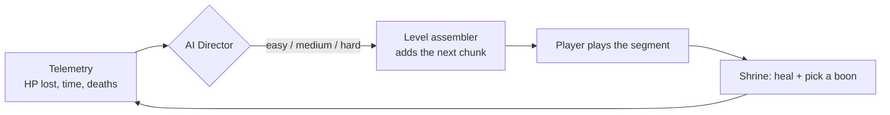

# The Odyssey: AI-Driven 2D Action Game (beta)

A 2D side-scrolling action platformer inspired by Homer's *Odyssey* (the Island of the Cyclops),
built in **Unity 6 (6000.3) and C#**. Its **AI Director** is a small **reinforcement-learning policy
(ML-Agents PPO / PyTorch)**. At each segment boundary it looks at how the player just did and
chooses the next segment's difficulty, aiming to keep every player challenged without being
crushed.

> **Status: beta.** There is one level of plain blocks (no art yet) and the Director is trained
> on simulated players. The "Status" and "Limitations" sections list what is done and what is
> not.

## What's in it

| Feature | Where it lives |
|---|---|
| 2D side-scroller inspired by the Odyssey | `Level01`: opening dialogue → 3 segments → the ship → end screen |
| State-machine combat | `Runtime/FSM` holds one generic state machine. Player states: Idle, Run, Jump, Fall, Attack, Hurt, Dead. Enemy states: Patrol, Chase, Attack, Hurt, Dead. Attacks use windup/active/recovery timing with a hitbox |
| Rogue-lite modifiers | `Runtime/Modifiers`: 6 *Boons of the Gods* (one per god), offered 3 at a time at the shrine after each segment, with stacking rules |
| Level assembly | `Runtime/LevelGen`: 6 hand-drawn ASCII chunks (2 easy, 2 medium, 2 hard), stitched together at runtime |
| AI Director | `Runtime/Director`: Fixed, Heuristic (rule-based) and RL directors behind one `IDirector` interface |
| ML-Agents, PyTorch | `ml/configs/director_ppo.yaml` is trained with `mlagents-learn` (PPO in PyTorch), exported to ONNX and run in-game |

## Controls
- **A/D** or arrow keys: move
- **Space/W**: jump (hold for a higher jump)
- **J** or left click: spear attack
- **1/2/3**: pick a boon at a shrine
- **Esc**: pause
- **F1**: show or hide the live Director readout

Gamepad is supported.

## How the game loop works



1. The run starts with the intro chunk and a short opening dialogue.
2. The Director picks a difficulty for segment 1. Nothing has been played yet, so it sees a neutral
   observation.
3. The level assembler adds a chunk of that difficulty. Difficulty sets three things: which chunk,
   how many of its enemy slots are filled (40/70/100%), and enemy strength (×0.8/1.0/1.3).
4. At the shrine gate at the end of the segment:
   - the segment's telemetry is saved
   - the player heals 15% and picks a boon
   - the Director picks the next difficulty
5. After 3 segments the ship chunk is added. Reaching the ship wins the run.
6. Dying respawns the player at the segment start. 3 deaths end the run.

## The AI Director

| | |
|---|---|
| **Input (4 numbers)** | HP lost in the last segment, time taken vs. a target time, whether the player died, the difficulty just played |
| **Output (1 choice)** | Next segment difficulty: easy, medium or hard |
| **Reward** | **+1** if the player lost 15–50% HP and didn't die; **−1** for a death; **−0.5** if it was trivially easy (<5% HP lost) |
| **Model** | PPO, small MLP (2 layers × 32 units), trained on CPU |

**In one line:** a PPO agent picks the next segment's difficulty from 4 telemetry features, and it
is rewarded for keeping the player's HP loss inside a target band.

**Training.** Real players are slow to collect, so training uses a **simulated player**
(`RunSimulator`) with three skill levels: novice, average and expert. One formula drives it:

```
challenge = difficultyFactor[easy=0.6, medium=1.0, hard=1.5] / (skill × power)
HP lost   = 0.35 × challenge^1.5 + random noise
```

The simulator follows the game's rules:
- HP carries over between segments.
- Shrines heal 15% and add 5% power.
- Dying respawns at full HP.
- 3 deaths end the run.

Each training episode is one run with a random skill level, so the policy has to *work out* which
kind of player it is facing from the telemetry. 16 agents train in parallel in the
`DirectorTraining` scene.

```bat
ml\train_director.bat director_v1
```

The script activates the `odyssey_ai` conda env (Python 3.10.12, mlagents 1.1.0, torch 2.2.2 CPU)
and runs `mlagents-learn`. When it prints *"Listening on port 5004"*, press Play in the
`DirectorTraining` scene in Unity. When training finishes, the script copies `Director.onnx` into
`Assets/ML/Models/` and exports the training curves to `results/training/`. Then run
**Odyssey → Assign Director Model To Scenes** in Unity.

**In the game,** the RL Director runs the ONNX model at each shrine through Unity's Inference
Engine. If no model is assigned yet, it falls back to the heuristic director and the HUD says so.
Every decision is printed to the console and saved to `telemetry.csv` in
`Application.persistentDataPath`.

## Evaluation
Run **Odyssey → Run Director Evaluation**. It plays Fixed (always medium), Heuristic (rule-based) and RL
directors against the same simulated players with the same random seeds (300 runs per skill
level), then writes `results/director_eval.md` and `.csv`. It reports three metrics:
- **In-band segments:** the share of segments where HP lost was 15–50% with no death
- **Runs completed:** the share of runs finished without losing all 3 lives
- **Deaths per run**

**Results: TODO.** They will be filled in from `results/director_eval.md` after the training run.

## Getting started
1. Open the folder in **Unity 6000.3.9f1** from Unity Hub. The first import downloads
   `com.unity.ml-agents@4.0.0`, which pulls in Inference Engine 2.2.1.
2. Run the menu **Odyssey → Build Project Content**. It creates the physics layers, the data
   assets and the 5 scenes: MainMenu, Level01, EndScreen, DirectorTraining and DirectorEval.
3. Open `Assets/Scenes/MainMenu.unity` and press **Play**. The *AI Director* button on the title
   screen switches between RL, Heuristic and Fixed.

To run the tests, use **Window → General → Test Runner → EditMode → Run All**.

## Code structure
```
Assets/Scripts/Runtime/
  FSM/        StateMachine + IState (shared by player and enemies)
  Combat/     HealthModel, Health, Hitbox, Projectile, IDamageable
  Player/     PlayerController + one class per state
  Enemies/    EnemyController + states; EnemyConfig assets (melee, rock thrower)
  Modifiers/  BoonDefinition assets + RunModifierRegistry
  LevelGen/   ChunkDefinition (ASCII map), ChunkLayout (parser), ChunkSelector, LevelAssembler
  Director/   IDirector, Fixed/Heuristic, ChallengeBand (reward), DirectorObservation
    Sim/      RunSimulator (simulated player) + DirectorEvaluation
    ML/       DirectorAgent (ML-Agents), RLDirector, training arena, evaluator
  Telemetry/  SegmentTelemetry + TelemetryTracker (CSV log)
  Core/ UI/ Dialogue/ Level/   run loop, HUD/menus, text boxes, shrine gate/ship/spikes
Assets/Scripts/Editor/   OdysseyBuilder: one click builds layers, data assets and scenes
Assets/Scripts/Tests/    Edit-mode NUnit tests
ml/                      PPO config, training script, curve export
tools/chunk_maps.py      Chunk maps + reachability check (regenerates DefaultChunks.cs)
```

Design choices:
- **One state machine for everything.** States are plain C# classes, and all transitions are
  declared in one place per character.
- **Data-driven.** Enemies, boons, chunks and dialogue are ScriptableObject assets, so a new
  enemy or boon is a new asset, not new code.
- **Testable core.** Health, boons, chunk parsing, the simulator, the directors and the reward
  are plain C#, so edit-mode tests cover them.
- **Generated scenes.** The scenes only hold bootstrap objects, which the editor builder creates.
  The UI is built from code.

## Tests (edit mode)
| Suite | What it checks |
|---|---|
| `StateMachineTests` | Transitions fire, Exit→Enter order, Any-state transitions take priority, no re-entering the same state |
| `HealthModelTests` | Damage, invulnerability frames, a single death event, heal clamp, max-HP change |
| `ModifierRegistryTests` | `(base + flat) × (1 + Σ%)`, max stacks, clear, one boon per god in offers |
| `LevelGenTests` | ASCII parsing and block merging, enemy slots, deterministic chunk and slot picks |
| `DirectorTests` | Observation size and range, reward values, the rule-based director, simulator determinism |

`python tools/chunk_maps.py` runs a reachability check: it confirms every chunk can be crossed with
the player's jump height and that no enemy slot floats in the air.

## Status
| Area | State |
|---|---|
| Gameplay, Director, scene builder, tests | Written, and compile-checked against Unity 6000.3.9f1's engine assemblies. The ML-Agents API was checked against stand-ins copied from the 4.0.0 source |
| Edit-mode tests | 18 of 24 pass outside Unity. The other 6 create ScriptableObjects and need the Unity Test Runner. TODO: run all in the editor |
| Play-testing in the editor | TODO |
| Director training / ONNX model | TODO |
| Evaluation numbers | TODO |
| Art and audio | Not planned for the beta. Everything is plain coloured blocks |

## Limitations
- **The Director is trained on simulated players, not humans.** The simulator's numbers are
  hand-picked assumptions. `telemetry.csv` records real play so it can be calibrated later.
- There is one short level with two enemy types. Difficulty changes only between segments.

## Study notes
For a full walkthrough of the code plus the theory (RL/PPO, ML-Agents, FSMs, dynamic difficulty,
Unity concepts) and likely interview questions, see [docs/PROJECT_NOTES.md](docs/PROJECT_NOTES.md).

## Credits
See [CREDITS.md](CREDITS.md). The code is MIT licensed (see `LICENSE`).
